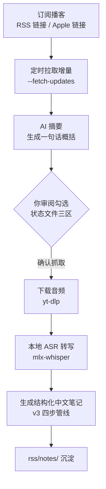

# rss-grab

订阅 RSS 播客 → 自动拉取增量 → AI 摘要 → 审阅勾选 → 下载 → ASR 转写 → 生成结构化中文笔记。

> **这是什么**：项目主体是一个 **Agent skill 包**（`.agents/skills/rss-grab/`），供 **Codex / Claude Code 等 AI 助手**编排使用——在对话里发一个播客 RSS 链接（或 Apple Podcasts 链接），说"订阅这个播客、拉取新期数、把感兴趣的转写生成笔记"，Agent 会按 skill 指令自动完成整条流水线。各脚本也自带命令行入口，可纯命令行操作（见「快速开始」）。

> ⚠️ **平台要求：仅支持 macOS（Apple Silicon，M1/M2/M3/M4）**
> ASR 转写依赖 mlx-whisper（Apple 的 MLX 框架，仅 Apple Silicon 可用）。
> **Windows / Linux / Intel Mac 用户**：请改用本地 [faster-whisper](https://github.com/SYSTRAN/faster-whisper) 或 [whisper.cpp](https://github.com/ggerganov/whisper.cpp) 做 ASR，或使用其他在线 ASR 服务，然后按 rss/transcripts/ 的格式输出分段时间戳内容（后续流水线依赖时间戳分段落盘）。
> 跨平台支持已在 Roadmap 中（见文末）。

## 为什么选 rss-grab

**它解决什么问题**：播客信息密度高、一期 35-60 分钟，靠"听"做知识管理效率低——你听完就忘，回找时只能凭记忆翻播放器历史。rss-grab 把**"听播客"变成"读笔记"**：自动拉取你订阅播客的新期数、生成摘要供你快速判断值不值得听、把选中的转写成文字稿、再生成结构化中文笔记沉淀下来——整个流程不靠你在播放器里手动操作，订阅后基本自动化。

**使用流程**：



**真实使用方式**（作者日常用法）：在 Apple Podcasts 里找到想订阅的节目，复制节目 web 链接（`podcasts.apple.com/...`）发给 Agent——Agent 会通过 **Apple 官方 iTunes Lookup 接口**取到这个节目的 RSS feed 地址完成订阅（只需链接里的那串节目 id，无需手动找 RSS 地址、无需 API 密钥）。之后节目每出新期，rss-grab 自动拉取增量 + 生成 AI 摘要，你在状态文件里勾选想深挖的期数，它再下载音频、本地转写、生成结构化笔记。**全程不需要手动找 RSS 地址、不需要记命令**。

**一句话定位**：rss-grab 是**开源的本地播客笔记工具**——订阅、下载、ASR 转写都在你机器上完成（Apple Silicon 本地推理），AI 摘要与笔记生成调用 OpenAI 兼容 LLM API。

**适合你，如果你**：
- **播客重度听众**：一期期听下来，想把内容沉淀成可检索的笔记，而不是听完就忘
- **主要听中文播客**：想要符合中文表达习惯的结构化笔记，而非英文优先的通用摘要
- **在意成本与隐私**：转写完全在本地完成（不消耗 LLM token、音频不出设备），只为摘要/笔记付少量的token
- **喜欢"收件箱"式工作流**：订阅后自动拉新期数、AI 摘要筛一遍、勾选想听的深挖，像处理邮件一样
- **用 Apple Silicon Mac**（M1/M2/M3/M4）：核心流程（抓取 + 转写）完全离线可用

**它做了什么**：
- **本地抓取 + 本地转写**：抓取与 ASR 转写（mlx-whisper，Apple Silicon 本地推理）都在你机器上完成；原始音频不离开设备，转写文本仅在与 LLM API 交互时上传（见「LLM 配置」）
- **三区状态机**：每源一份 Markdown 状态文件（待确认 / 确认 / 已转化），跟你用邮箱一样自然
- **Apple Podcasts 一键订阅**：粘一个 Apple 节目链接，通过 **Apple 官方 iTunes Lookup 接口**拿到该节目的 RSS feed 地址自动订阅
  - 调用方式：`GET https://itunes.apple.com/lookup?id=<节目id>&media=podcast`，返回 JSON 里的 `feedUrl`（RSS 地址）、`collectionName`（节目名）、`artistName`
  - **你只需要提供那串节目 id**（就在链接的 `id1200361736` 里），无需手动找 RSS 地址、无需 API 密钥
  - 查不到时返回 `resultCount=0`（链接失效/只是单集链接/节目已下架），会给出可操作的提示而不是报错
  - ⚠️ 别加 `country=CN` 参数——实测会让中国区节目查不到（`resultCount=0`）
- **长度自适应**：长短播客统一走 v3 四步管线，净字 15,000 只决定「一次调用」还是「分块扫描」——用户无感，入口只有一个
- **笔记结构可自定义**：v3 的输出结构由 `_shared/build_v3.py` 顶部的 prompt 模板驱动（`USER_TPL` / `USER_TPL_TOPICS`），改模板字符串即可调整产出风格，不用改管线逻辑

**为什么长短文分两条路**：超长播客（转写稿净字 > 15,000，约 2 小时以上）单次塞给 LLM 会超出 context 或质量下降。v3 自动走四步：①.5 错字纠错（LLM 出映射表、程序确定性替换）→ ② 按块扫描提要点 → ③ 合并去重 → ④ 撰写 → 程序化校验。好处：
- **无长度上限**：多长的音频都能转成完整笔记（>2h 的访谈、特辑都行）
- **更省 token**：每块只精读一次，摘要精简后再汇总，比一次塞全文便宜
- **质量更高**：每块单独精读不丢上下文，长播客的笔记完整度反而更好
- **断点恢复**：分段处理，单块失败可重试，不用全量重来

触发是自动的：`decide_mode.py` 按**净字数**判断（净字 = 剥 `**[mm:ss]**` 时间戳后去所有空白，阈值 15,000，实现在 `_shared/long_doc.py`），用户无感。实测多数播客（35-60 分钟）走单次调用。

**实测（2026-08，MacBook Pro M1 16GB）**：
- 本地转写模型跑得动——**2 篇共约 2.5 小时音频，转写约 10 分钟**（mlx-whisper large-v3-turbo，Apple Silicon 加速）
- 转写不消耗 LLM token、模型本地部署成本低、推理速度快——**音频转写是"免费"的（只花电费），只有 AI 摘要/笔记生成才消耗 token**

**诚实承认的限制**（按重要性排序）：
- **仅 macOS Apple Silicon**（mlx-whisper 硬性要求）— Windows/Linux 用户需自己改用 faster-whisper
- **CLI 优先**（没有 GUI）— 非技术用户上手有门槛

## 核心能力

| 能力 | 说明 |
|---|---|
| 订阅模式 | 订阅表 + 每源一个状态文件（待确认 / 确认 / 已转化 三区） |
| 定时增量拉取 | 增量命令幂等、可重复执行；可配合 launchd/cron 定时自动拉新期数 + AI 摘要 |
| AI 摘要 | 每期根据简介调用LLM生成"一句话概括"，用户无需打开音频即可判断是否值得听 |
| 批量下载 | 利用 yt-dlp 下载音频（串行 + CDN 礼仪间隔） |
| ASR 转写 | mlx-whisper large-v3-turbo（仅 Apple Silicon），带**时长完整性校验** |
| 笔记生成 | v3 四步管线（错字纠错 → 分块扫描 → 合并去重 → 撰写 → 校验），长短文同一入口，批量 20 并发 |
| 自动打标 | 笔记**落盘之后**另跑一次 LLM 生成 `tags`（与正文生成是两个独立阶段），可用体检脚本核查 |
| Apple Podcasts 反向解析 | 网页链接 → RSS feed URL 自动提取 |
| LLM 兼容 | OpenAI 兼容接口，不绑定任何特定服务，可配任意兼容服务 |

### LLM 调用策略

批量调用 LLM 时内置了并发与限流保护，避免打爆 API 或触发限流：

- **并发 20**：AI 摘要、批量笔记生成默认 20 并发（实测无 429 限流）
- **发射间隔**：每请求间隔 ≥2s（摘要与批量笔记同一档），避免瞬时请求风暴
- **429 熔断降级**：遇到限流自动降并发（摘要 20→15；笔记 20→15→10），并指数退避重试
- **断点续跑**：中断后重跑自动跳过已处理项（checkpoint 落盘），不会重复消耗 token
- **v3 分块扫描并发**：长播客②步分块并行精读（单块失败自动沿用原文并告警，不静默丢内容）
- **阶段 3 自动化默认 5 并发**（`NOTE_MAX_PARALLEL` 可调）：`generate_note_for_confirmed.py` 只处理「确认抓取」区的 `[x]`，待确认 `[ ]` / 确认不抓 `[~]` / 已转化 `[done]` 一律跳过——不为用户没审过的内容烧 token

### 自动打标（`tags`）

**标签不是笔记生成管线产出的**，是笔记落盘之后**单独再跑一次** LLM 生成的。

- 正文管线（v3）只写正文与信头，**不写 `tags`**；标签由 `scripts/retag.py` 补上
- 走的是 `scripts/retag_hook.py` 这个薄壳：单篇生成后立刻调一次，批量生成则把全部 id 一次传给同一个进程（避免每篇起一次进程、放大环境加载与限流风险）
- 打标失败**不影响正文**——正文已落盘，hook 只打印一行提示、不抛异常；痕迹是「`tags` 为空但转写状态正常」，交给体检脚本抓
- 打标输入是**产物自己的 `## TL;DR` + `## 要点总结` 两节**，刻意不喂发布者自打标签与标题（避免复读）；默认 ≤10 个

手动补跑（默认 dry-run，只报告不写盘）：

```bash
# 抽样看看效果（默认 6 篇）
python3 scripts/retag.py --source rss --sample 6

# 确认没问题再写盘
python3 scripts/retag.py --source rss --sample 6 --apply

# 只处理指定笔记
python3 scripts/retag.py --source rss --ids <note_id,note_id> --apply
```

体检（查标签漏跑、超数量上限、近义重复等）：

```bash
python3 scripts/audit_frontmatter.py --source rss
```

## 跟同类项目对比

| 维度 | rss-grab | Podwise（闭源） | MrRSS | RSS-GPT | Meetily |
|---|---|---|---|---|---|
| **播客专门** | ✅ | ✅ | ❌ 通用 RSS | ❌ 通用 RSS | ❌ 会议录音 |
| **本地 ASR** | ✅ mlx-whisper | ❌ 云端 | ❌ | ❌ | ✅ Whisper |
| **增量订阅模式** | ✅ 三区状态机 | ✅ 自动 | ✅ | ❌ 静态 | ❌ |
| **Apple Podcasts 反推** | ✅ | ❌ | ❌ | ❌ | ❌ |
| **中文结构化笔记** | ✅ | ⚠️ 英文优先 | ⚠️ 通用 | ⚠️ 通用 | ⚠️ 通用 |
| **离线运行** | ⚠️ 转写离线/摘要需联网 | ❌ | ⚠️ | ❌ | ✅ |
| **跨平台** | ❌ macOS only | ✅ Web/App | ✅ Docker | ✅ Actions | ✅ Tauri |
| **开源协议** | ✅ MIT | ❌ | ✅ | ✅ | ✅ MIT |
| **价格** | 免费 | $5.9/月起 | 免费 | 免费 | 免费 |
| **数据隐私** | ⚠️ 本地转写/LLM 见上 | ❌ 云端 | ⚠️ 自托管 | ❌ 云端 | ✅ |

**结论**：
- 与**云端播客笔记服务**相比，rss-grab 强调**开源 + 离线 + 中文化**
- 跟 **MrRSS / RSS-GPT** 偏通用 RSS 不同，rss-grab 专注**音频类 RSS** + **本地 ASR** + **长笔记生成**
- 跟 **Meetily** 思路接近（本地优先），但定位不同：rss-grab 处理"播客"，Meetily 处理"会议录音"

## 项目亮点

- **零门槛订阅**：在 Apple Podcasts 复制节目链接给 Agent，自动反推 RSS feed 完成订阅——不用手动找 RSS 地址
- **把"听"变成"读"**：播客 → 结构化中文笔记（含 TL;DR、关键引用、话题时间轴、信息可信度），可检索、可回看，告别听完就忘
- **收件箱式工作流**：订阅后自动拉新期数 + AI 摘要，勾选想深挖的期数才下载转写——不盲目抓取所有期数，节省磁盘、token 和时间
- **AI 驱动、自然语言编排**：面向 Codex / Claude Code 等 Agent 设计，对话即可驱动整条流水线，无需记忆命令
- **ASR 错字自动纠正**：机器转写（尤其中文）难免有同音错字（如"事故"vs"世故"）——生成笔记时 LLM 以节目元信息为权威参照主动识别纠正，并在笔记"信息可信度"里**透明列出**"原写 X、实为 Y、已修正"，不悄悄改
- **开源可审计**：MIT 协议，全流程本地运行，代码透明，数据自己掌控

## LLM 配置（OpenAI 兼容）

- 代码只走 **OpenAI 兼容接口**（`/chat/completions` + `reasoning_effort` 可选参数），**不绑定任何特定服务**——你的 `.env` 配哪家就用哪家
- **支持任意 OpenAI 兼容服务**（DeepSeek / OpenAI / MiniMax / 本地 Ollama 等），只需在 `.agents/skills/rss-grab/scripts/.env` 配置（模板见同目录的 `.env.example`，**只有这一份**）：
  ```bash
  LLM_API_KEY=your-key                    # 你的服务 API key
  LLM_BASE_URL=https://your-llm-service/v1   # 你的服务 base_url
  LLM_MODEL=your-model                    # 你的模型名（三项里最常需要改的一项）
  ```
- ⚠️ **两个常见踩坑**：
  1. **生效位置是 `scripts/.env`**（`.agents/skills/rss-grab/scripts/.env`）——放在仓库根目录的 `.env` 不会被读取；
  2. **`LLM_MODEL` 是必填**（三项都缺一不可），缺失时脚本会报错退出。
- 未配置 `LLM_BASE_URL` 时脚本会报错提示。

### 推理强度（`LLM_EFFORT`）

两个 LLM 环节的**默认档位不同**，都可用 `LLM_EFFORT` 统一覆盖：

| 环节 | 默认档位 | 为什么是这个档 |
|---|---|---|
| AI 摘要（`preview_podcast.py`） | `high` | 读一遍简介写两句话，不需要更深 |
| 笔记生成（`_shared/build_v3.py`） | `max` | 四步管线 + 校验，质量优先 |

- 解析顺序：**`LLM_EFFORT` → `MINIMAX_EFFORT` → 默认值**；模型名同理（`LLM_MODEL` → `MINIMAX_MODEL` → 内置兜底），所以厂商专有名的变量仍能用，通用名优先
- ⚠️ **`LLM_EFFORT=` 显式留空 = 完全不发 `reasoning_effort` 这个参数**。给**不支持该参数的服务**用——发了会直接报 400，整个脚本跑不起来
- 调高 effort 会明显多花 reasoning token（实测摘要档从 `high` 提到 `xhigh` 平均多花 2.9 倍），不确定时先留着默认值

## 两种使用方式

### 方式 A：Agent 驱动（推荐，面向 Codex / Claude Code 等 AI 助手）

把 `.agents/skills/` 目录放进 AI 助手能访问的项目目录（Codex 的项目目录、或 Claude Code 的工作区），然后在对话中直接用自然语言驱动：

```
"订阅这个播客：https://podcasts.apple.com/xxx
 拉取新期数，把待确认区里感兴趣的几期转写并生成笔记"
```

Agent 会读取 `.agents/skills/rss-grab/SKILL.md` 的指令，自动完成：订阅反推 → 拉增量 → AI 摘要 → 三区状态文件 → 勾选抓取 → ASR 转写 → v3 笔记。**无需记住任何命令**——skill 会把每一步要执行什么、产物落在哪都告诉你。

> 💡 把 `.agents/skills/` 当作"技能库"：除了 `rss-grab` 主 skill，共享模块 `_shared/`（ASR、env 加载、路径定位、批量笔记）会被 skill 自动引用，一并放入即可。

### 方式 B：命令行直接使用

不依赖 Agent，直接 `python3 .agents/skills/rss-grab/scripts/xxx.py` 跑各脚本（`--help` 查看参数）。适合想精确控制每一步、或做自动化脚本的用户。

## 安装

```bash
# 依赖（macOS）
brew install yt-dlp ffmpeg
pip3 install -r requirements.txt   # openai + mlx-whisper（模型见下）

# MLX-Whisper 模型（仅 Apple Silicon）
# ⚠️ tools/ 在 .gitignore 里（模型体积大），clone 下来是空的，需要自己建
# 1. 下载模型权重（约 1.6GB，只需一次）
huggingface-cli download mlx-community/whisper-large-v3-turbo
# 2. 建软链指向模型
mkdir -p tools/asr-poc/models
ln -s ~/.cache/huggingface/hub/models--mlx-community--whisper-large-v3-turbo \
  tools/asr-poc/models/whisper-large-v3-turbo
# （若尚未安装 huggingface-cli：brew install huggingface-cli 或 pip install "huggingface_hub[cli]"）

# API Key（AI 摘要 + 笔记生成）
# ⚠️ 生效位置是 scripts/ 目录（脚本只从这里读），仓库根目录的 .env 不会被读取
# 模板就在 scripts/ 目录里（全仓库唯一一份），在仓库根目录执行：
cp .agents/skills/rss-grab/scripts/.env.example .agents/skills/rss-grab/scripts/.env
# 编辑 .agents/skills/rss-grab/scripts/.env，填入你的 LLM_API_KEY（OpenAI 兼容接口）
# 可选：LLM_EFFORT 控制推理强度（见「LLM 配置」一节），给不支持该参数的服务要显式留空
```

## 快速开始（命令行）

```bash
# 1. 订阅一个播客
#
# 写法 A（推荐）：粘Apple Podcasts 节目链接，经官方 iTunes Lookup 接口反查 RSS 地址。
#   只需链接里那串节目 id，无需手动找 RSS 地址、无需 API 密钥。
#   ⚠️ 不要加 country 参数（实测会导致中国区节目查不到）。
python3 .agents/skills/rss-grab/scripts/fetch_rss_feed.py \
  --subscribe "https://podcasts.apple.com/us/podcast/id1200361736"
#   若链接的 id 查不到（resultCount=0：链接失效 / 只是单集链接 ?i=... / 节目已下架），
#   会给出中文可操作提示，此时改用写法 B。
#
# 写法 B：你手上只有 RSS feed 地址时，必须同时用 --feed-url 显式指定。
#   ⚠️ --subscribe 的第一个位置参数是按「Apple 链接」处理的，只对 podcasts.apple.com
#      域名做反查；单独传一个裸 feed 地址会直接报错退出
#      （"❌ 无 feed_url"），且不会建目录。
python3 .agents/skills/rss-grab/scripts/fetch_rss_feed.py \
  --subscribe "https://example.com/your-feed.xml" \
  --feed-url "https://example.com/your-feed.xml"
#
# 两种写法成功后都会自动建好 rss/订阅/ 目录、该节目的状态文件和 subscriptions.json

# 2. 拉取增量（新期数 + AI 摘要）
python3 .agents/skills/rss-grab/scripts/fetch_rss_feed.py --fetch-updates

# 3. 审阅：打开 rss/订阅/<节目名>.md，把想听的勾为 [x]（确认抓取）

# 4. 批量下载 + 转写
python3 .agents/skills/rss-grab/scripts/fetch_rss_feed.py --pick-subscribe rss/订阅/<节目名>.md
python3 .agents/skills/rss-grab/scripts/batch_transcribe.py

# 5. 为「确认抓取」区 [x] 的期数生成笔记（只处理已勾选的，不烧无谓 token）
python3 .agents/skills/rss-grab/scripts/generate_note_for_confirmed.py --all --dry-run  # 先看清单
python3 .agents/skills/rss-grab/scripts/generate_note_for_confirmed.py --all            # 再实跑

# 或全量批量（扫所有转写稿）
python3 .agents/skills/rss-grab/scripts/batch_notes.py
```

### 常用参数

多数脚本带 `--help`，下面是实际最常用的几个：

| 参数 | 脚本 | 作用 |
|---|---|---|
| `--transcribe` | `fetch_rss_feed.py` | 下载后**直接转写**，省掉分开跑两条命令 |
| `--force` | `fetch_rss_feed.py` / `batch_transcribe.py` / `generate_note_v3.py` | 跳过 dedup 强制重下 / 强制重转 / 强制重生成笔记 |
| `--max-updates N` | `fetch_rss_feed.py` | 配合 `--fetch-updates`：每源最多处理 N 期新增（0=全部）。**首次订阅几百期的大 feed 建议限 5**，否则一次性烧掉几百次摘要调用的额度 |
| `--retry-summary <guid>` | `fetch_rss_feed.py` | 单期重跑 AI 摘要（结果写回状态文件），不用整源重来 |
| `--sync-pick <状态文件>` | `fetch_rss_feed.py` | 按 checkbox（`[x]`/`[~]`/`[done]`）重新归区 + 更新提示行 |
| `--unsubscribe <节目名>` | `fetch_rss_feed.py` | 退订：从订阅表删除 + 状态文件标记已退订 |
| `--auto-notes` | `fetch_rss_feed.py` | 每抓成功一期就入笔记队列 |
| `--max-parallel N` | `generate_note_for_confirmed.py` | 阶段 3 并发数（默认 5，`NOTE_MAX_PARALLEL` 环境变量同效） |
| `--keep-audio` | `generate_note_for_confirmed.py` | 转写后**保留** `/tmp` 下的音频（默认删除；排障或想重听时用） |
| `--max-workers N` | `batch_notes.py` | 批量笔记并发数（默认 20） |

**定时拉取（可选）**：`--fetch-updates` 幂等、重复执行安全，可以配 launchd 每晚自动跑。

仓库里已经带了一份现成的入口脚本 **`.agents/skills/rss-grab/scripts/run_fetch_updates.sh`**，它会遍历 `rss/订阅/subscriptions.json` 里所有源，逐个拉增量 + 生成 AI 摘要。**建议直接用它，不要自己拼 `fetch_rss_feed.py --fetch-updates` 命令**，原因见下。

### 为什么用现成脚本，而不是直接调 py

| 能力 | 直接调 `fetch_rss_feed.py` |
|---|---|
| **单实例锁** | 无。上一轮没跑完时下一轮又起 → 两个进程同时拉同一批|
| **逐源串行 + 抖动** | 一次性并发拉所有源 → 容易触发平台限流 |
| **日志落盘** | launchd 静默失败你看不到（每晚 exit 127 跑三个月都没人知道） |

> ⚠️ 单实例锁最早用 `flock` 实现，**但 macOS 根本不自带这个命令**，锁形同虚设；现版改用 `mkdir` 的原子性 + PID 存活检查。

### macOS launchd 配置

1. 新建 `~/Library/LaunchAgents/com.example.rss-fetch.plist`（`com.example` 换成你自己的标识）：

```xml
<?xml version="1.0" encoding="UTF-8"?>
<!DOCTYPE plist PUBLIC "-//Apple//DTD PLIST 1.0//EN"
  "http://www.apple.com/DTDs/PropertyList-1.0.dtd">
<plist version="1.0">
<dict>
  <key>Label</key>          <string>com.example.rss-fetch</string>
  <key>ProgramArguments</key>
  <array>
    <string>/bin/bash</string>
    <string>/绝对路径/到/仓库/.agents/skills/rss-grab/scripts/run_fetch_updates.sh</string>
  </array>
  <key>StartCalendarInterval</key>
  <dict><key>Hour</key><integer>22</integer><key>Minute</key><integer>30</integer></dict>
  <key>RunAtLoad</key>     <false/>
  <key>EnvironmentVariables</key>
  <dict>
    <!-- ⚠️ launchd 的默认 locale 不含中文，脚本里的中文会触发 unbound variable -->
    <key>LANG</key>   <string>en_US.UTF-8</string>
    <key>LC_ALL</key> <string>en_US.UTF-8</string>
  </dict>
  <key>StandardOutPath</key><string>/绝对路径/到/仓库/rss/_logs/launchd.out.log</string>
  <key>StandardErrorPath</key><string>/绝对路径/到/仓库/rss/_logs/launchd.err.log</string>
</dict>
</plist>
```

2. **把所有 `/绝对路径/到/仓库` 换成你自己的实际路径**（共 3 处：脚本、日志、错误日志）。日志目录不用预先创建，脚本会自己建。

3. 加载并验证：

```bash
launchctl load ~/Library/LaunchAgents/com.example.rss-fetch.plist
launchctl list | grep rss-fetch        # 应看到 com.example.rss-fetch

# 想立刻试跑一次而不等 22:30：
launchctl kickstart -k gui/$(id -u)/com.example.rss-fetch
```

4. 看日志确认真的在跑：`tail -f rss/_logs/fetch-updates-*.log`

### Python 版本要求

脚本需要 **Python 3.12 或更高**。macOS 自带的 `/usr/bin/python3` 是 3.9，缺依赖，**不能直接用**。

脚本会按 `RSS_FETCH_PYTHON` 环境变量 → Homebrew 路径 → PATH 上的 `python3` 依次探测。如果你的 Python 装在别处，在 plist 里加一行：

```xml
<key>EnvironmentVariables</key>
<dict>
  <key>RSS_FETCH_PYTHON</key> <string>/你的/python3/路径</string>
</dict>
```

> ⚠️ launchd 给的 PATH 很干净，不含 pip 的用户安装目录。脚本已自行补上
> `~/Library/Python/3.12/bin`、`3.13/bin` 与 `/opt/homebrew/bin`，否则 yt-dlp
> 会找不到、每晚静默失败。

### cron 用户等价写法

```bash
30 22 * * * /bin/bash /绝对路径/到/仓库/.agents/skills/rss-grab/scripts/run_fetch_updates.sh >> /绝对路径/到/仓库/rss/_logs/cron.log 2>&1
```

### 可选：飞书表格镜像（`lark_sync.py`）

**飞书是可选增强，不是依赖**——不装飞书、不配凭证，这个脚本根本不会被调用，`run_fetch_updates.sh` 也完全不碰它。采集主链路不受任何影响。

想用的话：先 `lark-cli auth login`，再在 `.agents/skills/rss-grab/scripts/.env` 里配好表格凭证（变量名与说明见同目录 `.env.example` 的可选段），然后：

```bash
python3 .agents/skills/rss-grab/scripts/lark_sync.py push   # md → 飞书（新建 + 镜像列对齐）
python3 .agents/skills/rss-grab/scripts/lark_sync.py pull   # 飞书 → md（只回写状态列）
python3 .agents/skills/rss-grab/scripts/lark_sync.py sync   # 双向
python3 .agents/skills/rss-grab/scripts/lark_sync.py push-status  # 只把「已转化」回写飞书
# 通用参数：--dry-run（只预览不连飞书）/ --节目名 "xxx"（限单源）/ --force（push 才有效：全量重写镜像列）
```

分工上「状态列归飞书所有」是**结构上保证的**：`push` 更新已有记录时的载荷里根本不放状态这个键，`pull` 只投影「状态 + guid」两列——两边不会互相覆盖。

### 常见问题

| 现象 | 原因 |
|---|---|
| 到点了没反应 | 机器睡眠时 launchd 会跳过触发。醒来后用上面的 `kickstart` 手动补一次 |
| 日志里 `exit 127` | plist 里的脚本路径不对，或该文件不存在 |
| 拉取静默失败 | 看 `rss/_logs/launchd.err.log`；最常见是 Python 版本不够或 yt-dlp 不在 PATH |
| 改完 plist 不生效 | 需先 `launchctl unload` 再 `load` |

## 目录结构

```
.agents/skills/
├── rss-grab/                  # 主 skill（SKILL.md = 给 Agent 的指令文档）
│   ├── scripts/               # 流水线脚本（CLI 可直接调用）
│   ├── templates/             # v2 遗留的 Markdown 笔记模板（v3 生产路径不读此目录）
│   └── SKILL.md               # Agent 指令：触发条件 + 阶段 1-4 工作流 + 路径约定
└── _shared/                   # 共享模块（ASR 转写、.env 加载、路径定位、批量笔记、v3 管线本体）

scripts/                       # 跨阶段工具（入 git，不随 skill 走）
├── retag.py                   # 打标：按产物正文重生成 frontmatter 的 tags
├── retag_hook.py              # 打标接线薄壳：笔记落盘后被生成脚本调用
├── audit_frontmatter.py       # 产物体检（信头字段、标签质量 G1-G4 等）
└── _tag_limits.py             # 标签数量/长度阈值（retag 与体检共用的唯一真源）

rss/                           # 运行数据（安装后由脚本生成，不入 git）
├── 订阅/                    # 订阅表 + 每源状态文件（待确认/确认/已转化 三区）
├── raw/                     # 期数元数据（info.json，含 enclosure url）
├── transcripts/             # ASR 转写稿（可入 git 防丢失）
├── notes/                   # 结构化笔记（按源分目录）
└── _logs/                   # run_fetch_updates.sh / launchd 的日志（自动创建）

tools/                         # 本地模型权重（不入 git，见「安装」第 2 步）
└── asr-poc/models/whisper-large-v3-turbo/   # 软链到 huggingface 缓存

待抓取URL/                     # 手动维护的批量抓取清单（不入 git）
└── RSS.md                    # fetch_rss_pending.py 的输入：每行一个 `- [ ] <feed url>`
```

> **哪些目录不入 git**：`rss/`（运行数据）、`tools/`（模型权重，体积大且可重新下载）、`待抓取URL/`（个人抓取清单）都在 `.gitignore` 里，clone 下来后由脚本自行创建。`transcripts/` 与 `notes/` 是产物备份价值最高的，可以自行决定是否放开。

音频临时存 `/tmp/rss-grab-audio/`（转写后可用 `--cleanup-audio` 清理；info.json 里存了源 url，需要时可重下）。

## 测试

```bash
python3 -m pytest .agents/skills/rss-grab/scripts/tests/ .agents/skills/_shared/tests/ -v
```

其中 `test_open_source_guard.py` 是**开源边界守门测试**：扫描全仓库，禁止出现非本项目的平台特征（其他采集源的痕迹、专有字段名、本机绝对路径等）。它拦的是「git 历史不可逆」的那类事故——文件删了也留在历史里，只能前置拦截。改本仓库任何文件后都应跑一遍。

## 免责声明

本项目仅供个人学习与内容管理使用。抓取内容（RSS feed、音频）版权归原作者/平台所有；请遵守各平台服务条款与内容许可，勿将本工具用于任何商业或侵权用途。RSS 是公开标准，但请尊重播客作者的下载礼仪（脚本已内置请求间隔）。

## Roadmap

- [ ] **补建 `rss/raw/*.info.json`**：阶段 3 靠 info.json 里的 enclosure URL 下载音频，
      而它只在新拉取时生成。**手工加进状态文件、或早于该机制存在的条目没有它**，
      于是被勾成 `[x]` 后会卡在「找不到 info.json」。这类条目的数量取决于你的订阅历史
      ——手工导入过、或订阅时间早于该机制的节目，基本都会命中。修法二选一：
      ① `fetch_rss_feed.py --pick-subscribe` 先跑一遍补建（它会顺带下音频，
      与阶段 3 的 `ensure_audio` 有重复下载）② 让 `generate_note_for_confirmed.ensure_audio`
      在缺 info.json 时回 feed 现场取。
- [ ] **飞书表格凭证的配置方式**：凭证变量名以
      `.agents/skills/rss-grab/scripts/.env.example` 的可选段为准（该文件是唯一模板）。
      配错或缺失时 22:30 链路的 stage 2 / stage 4 会各失败一次——**非阻塞，不影响采集**。

### 夜间定时链路（22:30 触发）

| 阶段 | 做什么 | 失败是否阻塞 |
|---|---|---|
| 1 | `fetch_rss_feed.py --fetch-updates` 拉增量 + AI 摘要 | — |
| 2 | `lark_sync.py sync`：飞书状态 → md、镜像列对齐、归区 | **否** |
| 3 | `generate_note_for_confirmed.py --all`：按 `[x]` 抓取转笔记 | — |
| 4 | `lark_sync.py push-status`：把程序判定的「已转化」回写飞书 | **否** |

- **状态机按「转换」划分归属，不是按字段**：
  `待确认→确认抓取` / `待确认→确认不抓` 由**用户**在飞书发起，只往 md 走；
  `确认抓取→已转化` 由**程序**在产物验证通过后发起，只往飞书走。
  同一个转换只有一个方向，两边永不互相覆盖。
- **标 done 的判据是「笔记文件已落盘且 ≥1000 字节」，不是「生成脚本退出码为 0」。**
  生成失败一律保持 `[x]`，当晚不标 done、次晚自动重试。
- 阶段 2/4 缺 lark-cli、缺凭证、飞书 API 报错，一律记 WARN 后继续 ——
  飞书是可选视图，采集主链路不能被它拖停。

## Acknowledgments

rss-grab 站在巨人的肩膀上，感谢以下开源项目：

- **[openai-python](https://github.com/openai/openai-python)** (Apache 2.0) — OpenAI 兼容 API 客户端
- **[mlx-whisper](https://github.com/ml-explore/mlx-examples)** (MIT) — Apple Silicon 上的 Whisper 推理
- **[yt-dlp](https://github.com/yt-dlp/yt-dlp)** (Unlicense) — 播客音频下载
- **[FFmpeg](https://ffmpeg.org/)** (LGPL 2.1+) — 音频元数据探测
- **[curl](https://curl.se/)** (MIT) — RSS XML 抓取

## License

MIT
